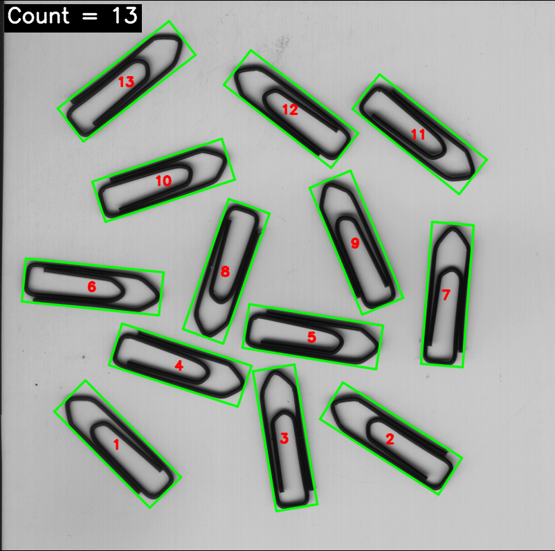
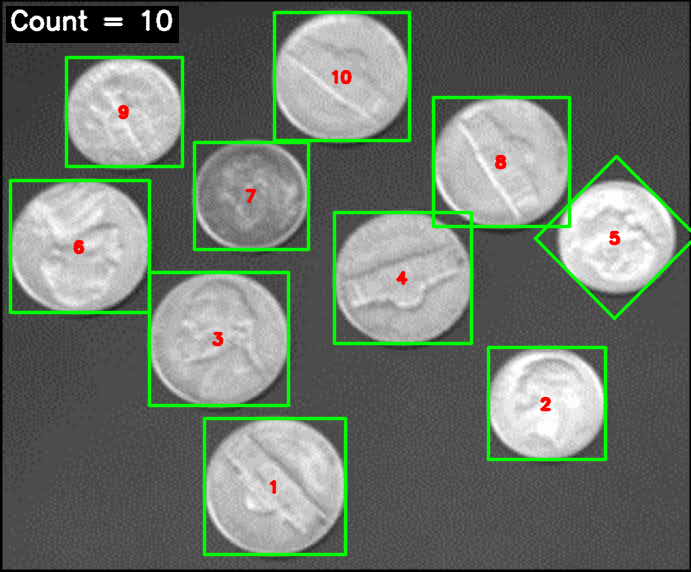
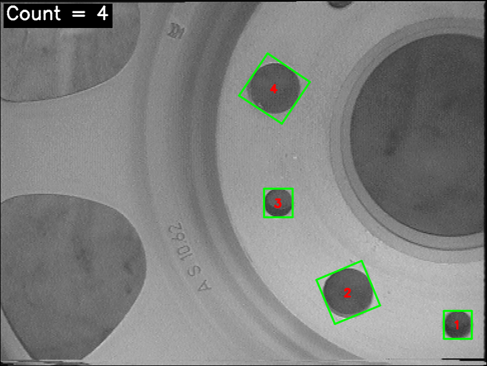

# 物体自动检测与计数（OpenCV C++）

对手拍照片中散落的同类物体进行**自动检测与计数**，输出每个目标的编号外接框、计数结果图和二值掩码图。
一个程序同时支持「浅底深物」与「深底亮物」两类图像，无需人工指定极性。

## 实测结果

| 图片 | 场景 | 人工核对 | 程序输出 |
| --- | --- | --- | --- |
| `微信图片_20261113134110_239_4.png` | 浅色底 + 黑色回形针 | 13 | **13** ✓ |
| `微信图片_20261113135738_240_4.jpg` | 深色底 + 亮硬币（含一枚发暗的） | 10 | **10** ✓ |
| `微信图片_20261113140508_242_4.png` | 法兰盘上的圆孔 | 4 个完整孔（顶部还有一个被画面截断） | **4** ✓ |

三张图均无漏检、无重复计数。







## 目录结构

```
.
├── main.cpp                                   # 主程序（算法 + 可视化）
├── build.bat                                  # MSVC 命令行编译脚本
├── .gitignore
├── 微信图片_20261113134110_239_4.png              # 原图 1：回形针
├── 微信图片_20261113135738_240_4.jpg              # 原图 2：硬币
├── 微信图片_20261113140508_242_4.png              # 原图 3：法兰盘圆孔
├── 微信图片_20261113134110_239_4_counted.png      # 输出：回形针标注结果
├── 微信图片_20261113134110_239_4_mask.png         # 输出：回形针二值掩码
├── 微信图片_20261113135738_240_4_counted.png      # 输出：硬币标注结果
├── 微信图片_20261113135738_240_4_mask.png         # 输出：硬币二值掩码
├── 微信图片_20261113140508_242_4_counted.png      # 输出：孔检测结果
├── 微信图片_20261113140508_242_4_mask.png         # 输出：孔检测二值掩码
└── README.md
```

## 算法原理

| 步骤 | 处理 | 目的 |
| --- | --- | --- |
| 1 | `cvtColor` 转灰度 + `GaussianBlur(3x3)` | 去掉彩色信息与传感器噪声 |
| 2 | `threshold(..., THRESH_BINARY \| THRESH_OTSU)` | 在"背景—物体"双峰直方图上自动找最佳分割阈值 |
| 3 | **自动极性判断**：白色面积 > 50% 则取反 | 解决 OTSU 分不出"哪一类是物体"的问题，一个程序兼容两类图像 |
| 4 | `MORPH_OPEN(3x3)` + `MORPH_CLOSE(9x9)` | 去零散噪点，把回形针的细缝、硬币的高光孔洞连成整体 |
| 5 | `findContours(RETR_EXTERNAL)` | 提取每个物体的最外层轮廓 |
| 6 | 面积 / 长宽比 / 填充度 三重过滤 | 剔除污渍、边缘暗角、传感器噪点 |
| 7 | `minAreaRect` + 编号标注 | 用**旋转外接矩形**贴合倾斜摆放的物体，比正矩形重叠更少 |

### 自动极性判断为什么有效

OTSU 只负责"把直方图分成两类"，不知道哪一类是目标。但散落物体的场景有共同前提：
**目标总面积一定远小于背景**。所以当二值结果里白色占了一半以上，就说明分出来的是背景，取反即可：

- 白底黑回形针：阈值 118，暗色区域占 14.7% → 白色是背景 → 取反 → 回形针为前景
- 暗底亮硬币：阈值 133，亮色区域占 31.2% → 白色是物体 → 不取反

### 三重过滤判据

- **面积**：占整幅图 0.3% ~ 15%（排除噪点与多物体粘连）
- **长宽比**：最小外接矩形长边/短边在 1.0 ~ 6.0（圆形硬币约 1.0，细长回形针约 2.5，贴边暗角条远超 6）
- **填充度**：轮廓面积 / 外接矩形面积 ≥ 0.25（空心与实心物体都满足）

参数集中在 `main.cpp` 的 `DetectParams` 结构体中，换图片时可整体调整。

## 孔检测模式（`holes`）

法兰盘照片里的目标不是"散落物体"，而是零件上的**圆孔**。这类图像的难点在于：

- 画面里有大面积暗区（左侧阴影区、右侧中心大孔），它们比背景暗，二值化后同样成为前景；
- 画面边缘有被截断的孔（顶部只露出一半），它不完整，不应计入；
- 还有刻字（`4 S 10bZ`）、刻痕、环带纹理等非圆目标。

因此孔检测模式在通用判据之外额外加了三项约束：

| 判据 | 取值 | 作用 |
| --- | --- | --- |
| 面积上限 | ≤ 3%（默认 15%） | 排除左侧阴影区、右侧中心大孔等大面积暗区 |
| 长宽比 | 1.0 ~ 1.6（默认 ≤ 6.0） | 排除刻字、条纹等细长目标 |
| 圆度 `4πA/P²` | ≥ 0.70 | 正圆为 1.0，不规则暗区远低于阈值 |
| 填充度 | ≥ 0.55 | 圆盘约 π/4 ≈ 0.785，空心或不规则形状不满足 |
| 完整性 | 外接矩形不得接触画面边缘 | 被截断的孔判为"不完整"，直接剔除 |

顶部那个孔正是靠**完整性判据**被排除的：它的外接矩形 `y ≈ 0`，紧贴画面上边界。

## 环境要求

- Windows + Visual Studio（本机验证：VS Community / MSVC 14.51）
- OpenCV 4.x（本机验证：OpenCV 4.6.0，`opencv_world460.lib`，**x64** 平台）

## 编译

### 方式一：命令行（一键）

```bat
build.bat
```

脚本内已配好本机的 VS 与 OpenCV 路径；若安装位置不同，改开头的 `VS_BUILD`、`OPENCV_BUILD` 两个变量即可。

### 方式二：Visual Studio 工程

1. 新建空项目（C++，**x64** 平台），添加 `main.cpp` 到源文件
2. 项目属性 → C/C++ → 常规 → 附加包含目录：`<opencv>\build\include`
3. 项目属性 → 链接器 → 常规 → 附加库目录：`<opencv>\build\x64\vc15\lib`
4. 项目属性 → 链接器 → 输入 → 附加依赖项：`opencv_world460.lib`（Debug 用 `opencv_world460d.lib`）
5. 把 `<opencv>\build\x64\vc15\bin` 加入 PATH（或调试工作环境），否则运行会缺 `opencv_world460.dll`
6. 注意本程序入口是 `wmain`（宽字符参数），MSVC 会自动选择 `wmainCRTStartup` 入口，无需手动设置

## 运行

```bat
obj_count.exe
```

不带参数：自动处理当前目录下所有 `png/jpg/jpeg/bmp/tif` 图片，逐张计数并输出结果图。

指定图片：

```bat
obj_count.exe "微信图片_20261113134110_239_4.png" "微信图片_20261113135738_240_4.jpg" nogui
```

孔检测模式加 `holes`：

```bat
obj_count.exe "微信图片_20261113140508_242_4.png" holes nogui
```

| 参数 | 说明 |
| --- | --- |
| 任意个图片路径 | 要处理的图片；不填则自动扫描当前目录 |
| `holes` | 启用孔检测模式：只统计完整的圆孔（圆度、面积上限、完整性收紧） |
| `nogui` | 不弹窗，仅保存结果（适合批量或无桌面环境） |

实际输出：

```
已读入图像：微信图片_20261113134110_239_4.png  (802 x 796)
OTSU 阈值：118，目标占比：14.7257%（目标比背景暗，已取反）
检测到目标数量：13
...
已读入图像：微信图片_20261113135738_240_4.jpg  (691 x 572)
OTSU 阈值：133，目标占比：31.233%（目标比背景亮）
检测到目标数量：10

================ 检测汇总 ================
  微信图片_20261113134110_239_4.png  ->  13 个
  微信图片_20261113135738_240_4.jpg  ->  10 个
成功 2 张，失败 0 张
```

孔检测模式输出：

```
检测模式：孔检测（只统计完整的圆孔）
已读入图像：微信图片_20261113140508_242_4.png  (818 x 614)
OTSU 阈值：126，目标占比：44.94%（目标比背景暗，已取反）
检测到目标数量：4

================ 检测汇总 ================
  微信图片_20261113140508_242_4.png  ->  4 个
成功 1 张，失败 0 张
```

## 关键技术点

### 1. 中文路径处理

OpenCV 的 `imread` / `imwrite` 只接受窄字符路径，中文文件名在 Windows 上会读取失败。
本程序使用 `wmain()` 接收宽字符参数，并以**宽字符文件流 + `imdecode` / `imencode`** 读写图像，
因此任意中文文件名都能正常工作，无需修改系统区域设置。

### 2. 为什么不用大核形态学估计背景

曾尝试用「大核闭运算估背景 + 黑帽变换」统一处理两类图像，但对密集分布的暗物体图像，
大核 `open` 会在腐蚀阶段把暗区扩张到整幅图，膨胀阶段无法恢复，导致背景估计整体偏暗、掩码失效。
OTSU + 极性判断的方案没有这个问题：它只用全局灰度分布，不依赖空间尺度，对物体疏密、尺寸差异都更鲁棒。

### 3. 弱对比目标（那枚发暗的硬币）

硬币图中间一枚硬币明显偏暗，与背景对比度低。在 OTSU 全局阈值下它仍落在亮侧，因此被正确检出（图中编号 7）。
若目标与背景灰度几乎重合，需要改用局部自适应阈值或 CLAHE 预增强。

## 已知局限

- 两个物体**紧贴或重叠**时会被判为一个连通域，面积超上限后被过滤而漏计；如需处理，应先做分水岭或距离变换分割。
- 目标占比接近 50% 时自动极性判断会失效，此时应显式指定极性。
- 极端光照（强反光、物体与背景灰度接近）下建议先做预处理或改用手动阈值。
